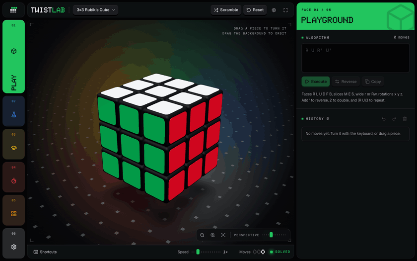

# TwistLab

<p align="center">
  <a href="https://mithilbatra.github.io/TwistLab/"></a>
</p>

<p align="center">
  <a href="https://mithilbatra.github.io/TwistLab/"><b>Try it live</b></a> &nbsp;·&nbsp; runs in the browser, nothing to install &nbsp;·&nbsp; <a href="LICENSE">MIT licence</a>
</p>

An interactive 3D playground for twisty puzzles. Fifteen puzzles are playable: cubes from 2×2 to 7×7, the Pyraminx, Skewb and Megaminx, the Dino and Redi Cubes, and four shape mods. Each has its own geometry, mechanics, notation, scrambles and test for being solved. Turn them with the keyboard, by dragging a piece or with notation, run algorithms move by move, learn the beginner's method on the 3×3, and time your solves.

Ten more, from the Square-1 to the Ghost Cube, are listed in the Puzzle Library as coming soon.

## Features

- **Fifteen 3D puzzles**, each drawn from its own pieces. Cubes are built from rounded cubies (26 on a 3×3, 218 on a 7×7); every other puzzle is cut from its real shape by its real cuts. Studio lighting, a floor of dots and contact shadows.
- **Puzzle Library**: every puzzle by category (Classic Cubes, WCA Puzzles, Shape Mods, Mechanical Puzzles, Advanced Puzzles), with its difficulty and a short description. Choose one to look at it on the stage from any side, then press Play to turn it.
- **An interface made of cube parts.** The six sections are the six faces: each has a sticker colour, and that colour becomes the accent of the whole interface while the section is open. Every move is drawn as a sticker in the colour of the face it turns, so an algorithm reads as a strip of colour.
- **Turn it** with the keyboard, by dragging a piece, or with the puzzle's own notation. Orbit, zoom, reset the camera and change the perspective.
- **Algorithm playground**: a real parser with clear syntax errors, play / pause / resume, step forward and back, reverse, copy, adjustable speed.
- **Scramble, reset, undo, redo** and a full move history.
- **Algorithm Lab**: 61 checked algorithms across OLL, PLL (all 21), F2L, cross, beginner method, two-look CFOP and finger tricks. Each one sets up the case it solves and plays step by step. Favourites are saved.
- **Learn**: the seven-step layer-by-layer method. Each step greys out the pieces you do not need yet, demonstrates its algorithms on the cube, and gives random practice positions that are judged on the cube's real state.
- **Timer**, for every puzzle: Space to start and stop, configurable inspection, scrambles shown on the puzzle, best / mean / average of 5 / average of 12 kept per puzzle, a time-distribution chart, per-solve delete. Saved in the browser.
- **A stage that reacts**: the last move stands behind the cube in dot-matrix type, the light behind the cube takes the colour of the face that turned, and all six colours bloom when the cube comes out solved.
- **Responsive**: a rail of six stickers and a control panel on desktop, a tab bar and stacked layout on phones.

## Puzzles

| Puzzle | Category | How it turns | Written as |
| --- | --- | --- | --- |
| 2×2 to 7×7 cubes | Classic Cubes | Faces, inner layers and wide turns, in quarter turns | `R U2 2F' 3Rw M x` |
| Pyraminx | WCA Puzzles | Four corners in thirds; a tip can turn on its own | `U L' R b` |
| Skewb | WCA Puzzles | Four corners in thirds, each carrying half the puzzle | `R U' L B` |
| Megaminx | WCA Puzzles | Twelve faces in fifths | `R U2' BR DBL' R++ D--` |
| Mirror Cube, Mirror 2×2 | Shape Mods | A 3×3 or 2×2 inside blocks of different sizes; solved by shape | as a 3×3 or 2×2 |
| Fisher Cube | Shape Mods | A 3×3 turned 45° inside its cube; solved by shape | as a 3×3 |
| Barrel Cube | Shape Mods | A 3×3 with its four upright edges cut away; solved by shape | as a 3×3 |
| Dino Cube | Advanced Puzzles | Eight corners in thirds, each moving three edges | `UFR DBL'` |
| Redi Cube | Advanced Puzzles | Eight corners in thirds, around six fixed centres | `UFR DBL'` |

Coming soon:

- **Square-1** and **Rubik's Clock**, the two WCA puzzles still missing. Neither is made of rotating layers: the Square-1 changes shape as it turns, and the Clock is dials set by wheels and pins. Each needs an engine of its own.
- **Gear, Mixup and Helicopter Cubes**: geared turns, or turns that stop part-way and jumble the pieces.
- **Ivy Cube**: its cuts are curved, and the geometric engine only cuts with planes.
- **Windmill, Axis and Ghost Cubes, and the Mastermorphix**: 3×3 shape mods that the geometric engine can already describe. Each still needs its real proportions.

## Quick start

Requires Node 20.19 or newer.

```bash
npm install
npm run dev
```

Open http://localhost:5173.

| Script | What it does |
| --- | --- |
| `npm run dev` | Start the dev server |
| `npm run build` | Type-check and build to `dist/` |
| `npm run preview` | Serve the production build |
| `npm run typecheck` | Type-check only |
| `npm test` | Unit and component tests (Vitest) |
| `npm run test:watch` | The same, in watch mode |
| `npm run test:e2e` | End-to-end tests (Playwright) |

The end-to-end tests run in the Chrome already installed on your machine. To use Playwright's own Chromium instead, remove the `channel` line in `playwright.config.ts` and run `npx playwright install chromium`.

## Controls

### Keyboard

| Key | Action |
| --- | --- |
| `R` `L` `U` `D` `F` `B` | Turn that face clockwise |
| `M` `E` `S` | Slice turns (odd cubes and the 3×3 shape mods) |
| `X` `Y` `Z` | Rotate the whole puzzle |
| `Shift` + key | The same turn counter-clockwise |
| `Alt` / `⌥` + face key | Wide turn: the face and the layer behind it. On a Pyraminx, the tip alone |
| same key twice | Half turn |
| `Space` | Play or pause the loaded sequence |
| `←` `→` | Step back or forward through the sequence |
| `Ctrl` / `⌘` + `Z` | Undo |
| `Ctrl` / `⌘` + `Shift` + `Z`, or `Ctrl` + `Y` | Redo |
| `Enter` in the algorithm field | Execute |

On other puzzles a key turns whatever has its name: `R` `U` `L` `B` are corners on a Skewb or Pyraminx and faces on a Megaminx. Keys a puzzle has no move for do nothing, and the shortcut reference shows what each key does on the puzzle on stage. The Dino and Redi Cubes name their turns by corner (`UFR`), so they are turned by dragging or with notation.

In the timer: hold `Space` and release to start (inspection first, if enabled), press `Space` to stop, `Esc` to cancel the attempt. Move keys are off while the timer or the Puzzle Library is open.

Every move key can be changed in **Settings → Keyboard**. Shortcuts never fire while you are typing in a field, and the in-app reference (**Shortcuts** in the bottom bar) always shows the keys as currently bound.

### Mouse and touch

- Drag a piece to turn it. Of the turns that would carry it, the one that moves the piece most nearly the way you dragged wins, so the layer follows the pointer as on a real puzzle.
- Drag the background to orbit. Scroll or pinch to zoom. In the timer and the Puzzle Library the puzzle is only there to look at, so every drag orbits.
- The buttons at the bottom right of the stage zoom, reset the camera and change the perspective.

### Notation

```
R U R' U'          faces, with ' for counter-clockwise
R2 U2'             half turns
M E S              slices        (follow L, D and F)
r l u d f b        wide turns    (Rw, Lw … also accepted)
2R 3Rw 3r          inner layers, and wide turns three deep   (4×4 and up)
x y z              rotations     (follow R, U and F)
(R U R' U')3       groups with a repeat count, nestable
RUR'U'             spaces are optional
```

Other puzzles keep the same grammar with their own moves, listed in the table above and under the algorithm field: a turn's amount goes after its name (`BR2'` is two fifths back), and groups and repeats work everywhere. One bad token rejects the whole algorithm, with the reason and its position. Nothing is partly executed.

## Architecture

```
src/
  engine/                 pure TypeScript, no React, no three.js
    core/
      math.ts             integer vectors and rotation matrices
      geometry.ts         convex solids and plane cuts, for the geometric puzzles
      Move.ts             move type, move tables, inversion, formatting
      CubeState.ts        cubies, applying moves, the solved test
      MoveParser.ts       notation parsers with positioned errors
      CubeValidator.ts    reachability checks for cubes of any size
      scramble.ts         scramble generator
    puzzles/
      PuzzleEngine.ts     the interface every puzzle implements, and what the library shows
      cubePuzzle.ts       n×n×n cubes, from 2×2 to 7×7
      twistPuzzle.ts      every other puzzle, built from its geometry
      index.ts            the puzzles, their definitions, and those still to come
    animation/
      AnimationQueue.ts   sequences turn animations, framework-free
    algorithms/
      AlgorithmLibrary.ts the algorithm data
      lessons.ts          lesson data, stage logic, practice generator
  store/                  Zustand stores: cube, algorithm playback, timer, settings
  hooks/useKeyboard.ts    global shortcuts
  components/             cube (3D: CubeModel, PieceModel, Viewport), layout, algorithm, timer, statistics, ui
  pages/                  one panel per section
  utils/stats.ts          time formatting, averages, histogram
e2e/                      Playwright tests
```

Data flows one way:

```
key / drag / notation ──▶ cube store ──▶ engine.apply ──▶ new logical state   (synchronous, exact)
                              │
                              └──▶ AnimationQueue { move, from, to } ──▶ CubeModel or PieceModel draws it each frame
```

### The cube engine

A cube is a list of **cubies**. Each cubie is a rigid body with a position and an orientation, and nothing else. Sticker colours are never stored or permuted: a sticker is simply whichever home face of a cubie currently points outwards. This is what makes it impossible to "fake" a move by repainting stickers.

- **Coordinates.** Layers along each axis sit at `-(n-1) … n-1` in steps of 2, so they are integers for every size: `-2, 0, 2` on a 3×3, `-1, 1` on a 2×2 and `-6 … 6` on a 7×7. `+x` is right, `+y` is up, `+z` is front.
- **Moves for every size.** The move table is built from the size: faces, then for each face the inner layers behind it (`2R`, `3R` …) and the wide turns that take them (`r`, `3r` …), and slices only where there is a middle layer.
- **Orientation** is a 3×3 rotation matrix. Every legal turn is a multiple of 90° about a coordinate axis, so every matrix entry is -1, 0 or 1.
- **A move** rotates every cubie in its layers: `pos' = R · pos` and `rot' = R · rot`, with the same `R` for both. `turns` is the signed number of quarter turns about the positive axis (right-hand rule), so `R`, clockwise when you look at the right face, is -1 about `+x`.
- **No drift.** The engine is integer-only. A state reached after a million moves is exactly as precise as the first one, and undo (the inverse turn) restores the previous state bit for bit.
- **Solved** is judged by stickers, not positions: all stickers that started on one face must still point the same way. A cube rotated as a whole is solved, and so is one whose centres have been twisted in place.
- **Validation** (`CubeValidator.ts`) checks structure (proper rotations, `pos = rot · home`, no shared positions) and the quantities every legal turn preserves: corner twist is a multiple of 3, and on odd cubes the middle edges' flips are even and the centres move as one rigid frame. Permutation parity is checked per kind of piece against the patterns turns can produce, which it works out for each size by trying a quarter turn of each layer. That is why a 4×4 accepts two swapped edge pieces, its famous parity, but not two swapped corners.

### The geometric engine

Every other puzzle is described by its geometry (`twistPuzzle.ts`): an outer shape, the axes it turns about and how far each turn goes round (a third, a fifth, a quarter), and the planes that separate what turns from what stays. Everything else follows from that description.

- **Pieces** are whatever the cuts leave of the shape. A Megaminx's 62 pieces, and the hidden core under them, come out of cutting a dodecahedron with twelve planes. Nothing is listed by hand.
- **State** is one number per piece: which rotation of the puzzle's symmetry group has carried it from its solved place. The group is generated once, from one step of each axis, and a turn is a lookup in its multiplication table. As with the cubes, there is no floating point in the state, so nothing drifts.
- **A move** turns the pieces whose centre lies beyond its cut, read off the current state, so a turn always takes what is in its layer now.
- **Solved** means one of two things. By colours: every sticker of a colour faces the same way. By shape, for the one-colour shape mods: the outside of the puzzle is back where it is on a solved puzzle turned some way round. Pieces that look alike may trade places, and a centre twisted where its shape hides it does not count.
- **The same description draws it.** `PieceModel` builds each piece's mesh from its solid, with a sticker standing proud on each outer face, and drag-to-turn asks the engine which turns would carry the grabbed piece.

The shape mods are a 3×3 or 2×2 mechanism inside a different shape: off-centre blocks for the Mirror Cube, a cube turned 45° for the Fisher Cube, a cube with its upright edges cut away for the Barrel Cube.

### Logic first, animation after

The logical state updates **synchronously** on every move and never waits for an animation. Each turn is then queued for the renderer together with the exact engine state before and after it.

`CubeModel` does not integrate anything over time. Every frame it places each cubie from an exact engine state, then rotates the cubies of the turning layer together about the turn axis by the eased angle. When a turn finishes, the next frame draws the exact state after it. So:

- rendered and logical state cannot diverge, whatever is queued, sped up or interrupted;
- overlapping input is safe: turns queue up, and a backlog (a scramble, fast typing) simply plays faster;
- animating allocates nothing per frame and causes no React re-renders;
- the canvas renders on demand, so an idle cube costs no GPU time.

Turns are tweened in the React Three Fiber frame loop with a cubic ease, rather than with a separate animation library. One clock drives everything, and the queue can be stepped deterministically in tests.

### The look

The interface is built from the cube itself, in three ideas. The tokens and the handful of custom utilities behind them are in `src/index.css`.

- **Six faces, six colours.** `NAV` in `Sidebar.tsx` gives each section a face. The app root carries it as `data-sticker`, and CSS turns that into the accent colour for everything inside.
- **Moves are stickers.** `turnedFace` in `CubeState.ts` reads the colour of the face a move turns off the centres, so the colour is right however the cube is held: on a cube held yellow-up, `U` is a yellow sticker. Slices and rotations turn no single face and stay grey, and so does every move on a 2×2, which has no centres. `turnedFaces` does this for a whole sequence, following the centres through wide moves, slices and rotations.
- **Dots.** Display type is [Doto](https://github.com/oliverlalan/Doto), a dot-matrix face whose glyphs are grids of squares. It is used large (the clock, the move on stage) and, joined into solid strokes by a hairline outline, for titles and counters. The floor under the cube is the same grid in perspective.

The stage behind the cube is plain HTML and CSS. The 3D canvas is transparent and sits in front of it, so the glow and the giant move letter are hidden by the cube exactly as if they were behind it. Nothing on the stage animates once it has settled, so an idle cube still costs no frames.

### Adding a puzzle

The stores, playback, history, timer and UI use only the `Puzzle` interface, so how much work a puzzle takes depends only on how unusual it is.

- **Another cube size** is one line in `src/engine/puzzles/index.ts`: `createCubePuzzle(n, …)` builds its pieces, moves, notation, scrambles and parity rules.
- **A puzzle made of planar cuts** is one `TwistDef` in the same file: its shape, axes, cuts, move names and scramble. The Redi Cube is fourteen lines. Its pieces, mechanics, parser, solved test and 3D model all follow from that.
- **Anything else** (the Square-1, the Clock) implements `Puzzle<State, Move>` directly and supplies its own model, as `CubeModel` and `PieceModel` do.

Then move it out of `COMING_SOON`, and add its checks to `puzzles.test.ts`.

## Testing

```bash
npm test          # 293 unit and component tests
npm run test:e2e  # 15 end-to-end tests in a real browser
```

What is verified:

- **Move algebra**, on every cube from 2×2 to 7×7: `R R'` and `U U'` restore the state, `R2 = R R`, `R` four times is the identity, every move undone by its inverse (all positions and orientations), 300 random algorithms undone by their reversal, 50 scrambles undone by their inverse.
- **Bigger cubes**: inner layers and deep wide turns agree with each other (`r = R 2R`, `3r = x L` on a 4×4), each size refuses the moves it does not have, scrambles use the turns and lengths competitions use, and the 4×4's edge parity is reachable while a lone corner swap is not.
- **Every other puzzle**: each move undone by its inverse and brought back round by its order, 30 scrambles undone, 40 scrambles' worth of random turns staying valid, notation read back exactly as written, and a mesh for every piece.
- **Known counts**: brute-force searches reach exactly the 11,520 edge arrangements of a Pyraminx, the 360 centre and 8,748 corner arrangements of a Skewb, and only the even half (60 of 120) of the ways two neighbouring corners can shuffle the edges of a Dino or Redi Cube. A Megaminx face turns 11 pieces and comes back after five; the Mirror Cube keeps the orders of a 3×3 (105 for `R U`, 1260 for `R U2 D' B D'`).
- **Solved by shape**: the shape mods are solved however they are held, and a twisted centre counts exactly where its shape or colours give it away (on a Fisher Cube, `R U` needs 420 repeats rather than 105).
- **Conventions**: each face turns clockwise seen from outside; slices, wide moves and rotations agree with their definitions in terms of face turns (`M = x' L' R`, `r = R M'`, …).
- **Known results**: `R U R' U'` has order 6, `R U` has order 105 (15 on a 2×2), `R U2 D' B D'` has order 1260.
- **Face colours**: the colour named for each move follows the centres through rotations, slices and wide moves, and a 2×2 names none.
- **Validity**: 3000-move random walks through faces, slices, wide moves and rotations stay valid at every step; the validator rejects a twisted corner, a flipped edge, a swapped pair, impossible centres and broken structure.
- **Parser**: valid notation, groups and repeats, and 17 kinds of invalid input, each with its error position.
- **Animation**: the model comes to rest on exactly the logical state; completing animations never changes the logical state; moves, undo and redo arriving mid-animation stay consistent.
- **Algorithm library**: every OLL keeps the first two layers, every PLL only permutes the last layer, all 21 PLLs have distinct effects, F2L and cross cases touch only what they should.
- **Lessons**: each demonstration reaches its goal, practice positions keep earlier steps solved, and each situation named in the text matches the position shown.
- **Stores and UI**: undo/redo, playback, the timer state machine, statistics, corrupt saved data, shortcuts standing down while typing, key rebinding.
- **End to end**: keyboard turning, algorithm execution, drag-to-turn with the correct direction, scramble/reset, the 2×2, a 5×5 and a 4×4, the Pyraminx and Megaminx, a Mirror Cube solved by shape and turned by dragging, the library's look-only stage, lab and lesson demos, timer persistence across a reload, and the phone layout.

Randomised tests use a seeded generator, so a failure names the seed that reproduces it.

## Saved data

Stored in `localStorage` under `twistlab.settings`, `twistlab.algorithms` (input, favourites, lesson progress) and `twistlab.timer` (solves). Saved data is validated when it is loaded. **Settings → Saved data** deletes solves or resets lesson progress.

There is no backend. The stores are the only place that reads or writes saved data, so accounts and sync can be added behind them.

## Known limits

- Scrambles are random-move (20 moves on a 3×3, 10 on a 2×2, up to 100 on a 7×7; the Megaminx uses the competition's row format), not WCA random-state. Random-state scrambles need a solver.
- For puzzles other than cubes, validation checks structure only (every piece a known rotation, in a slot of its own), not every reachability rule. Their states only ever come from their own moves, so this cannot be hit in the app.
- Shape-mod proportions are close to the real puzzles, not measured from them.
- The timer has no +2 or DNF penalties. If inspection runs out, the solve starts.
- The Algorithm Lab and lessons are for the 3×3.
- Undo covers turns. Reset and scramble start a new history.

## Licence

[MIT](LICENSE).
